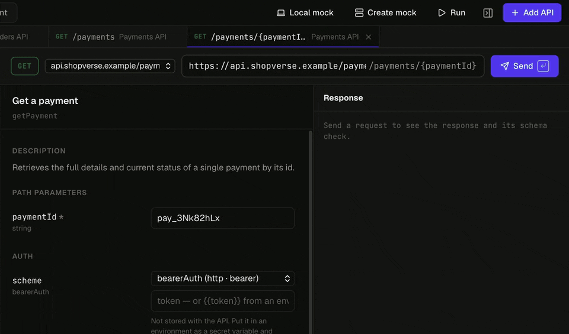
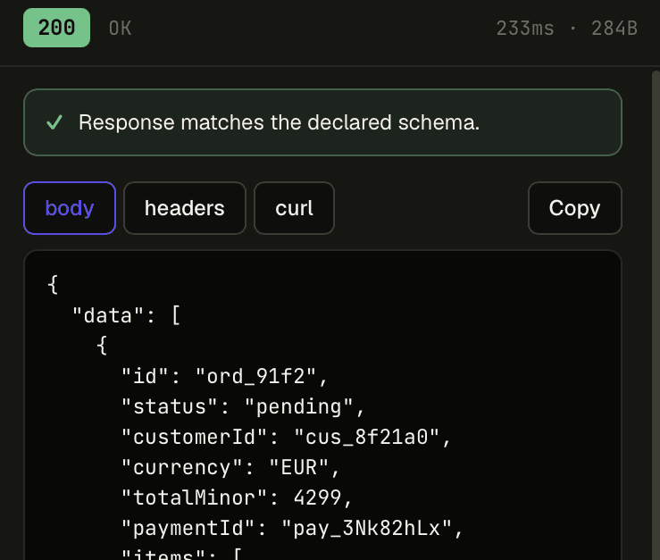
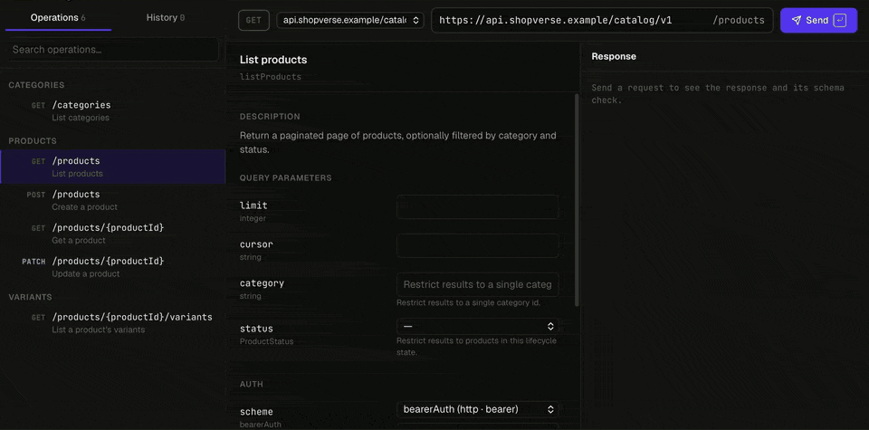
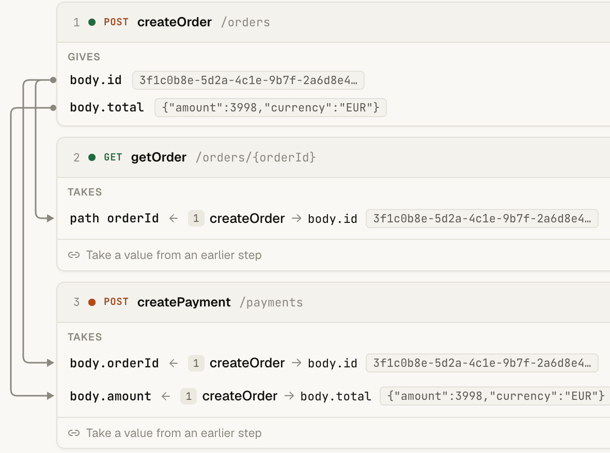
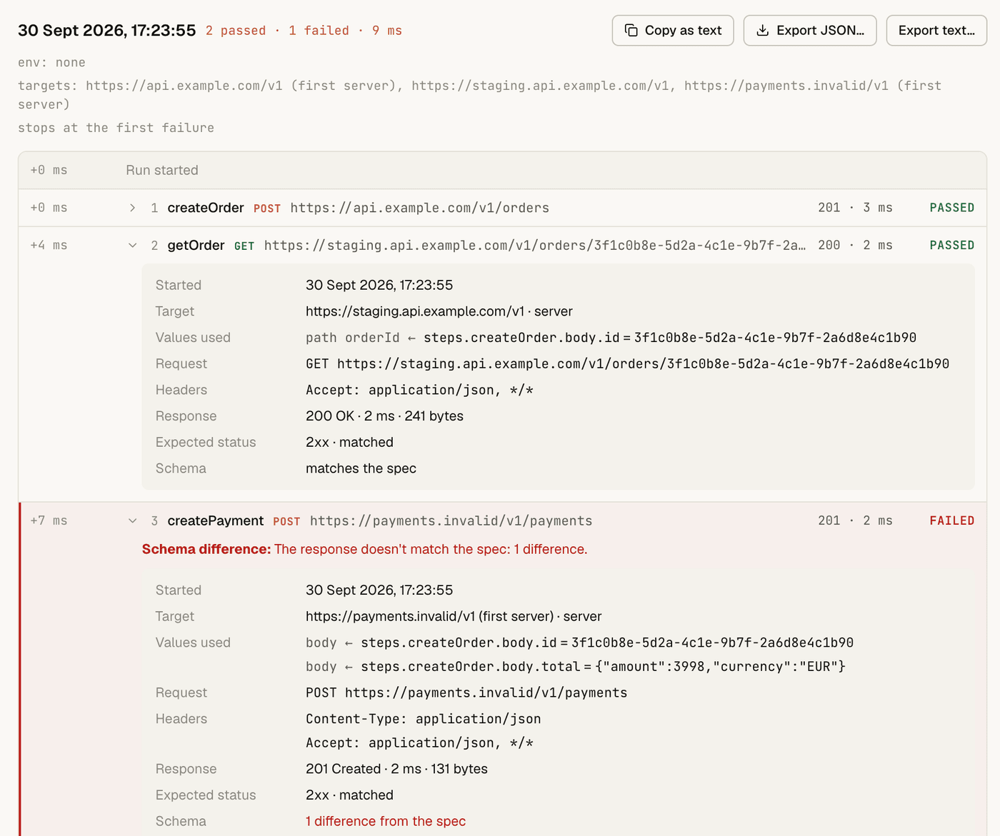
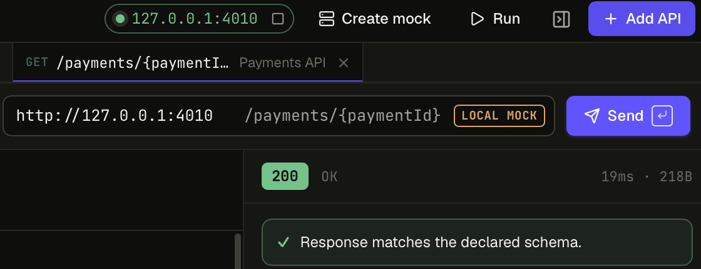
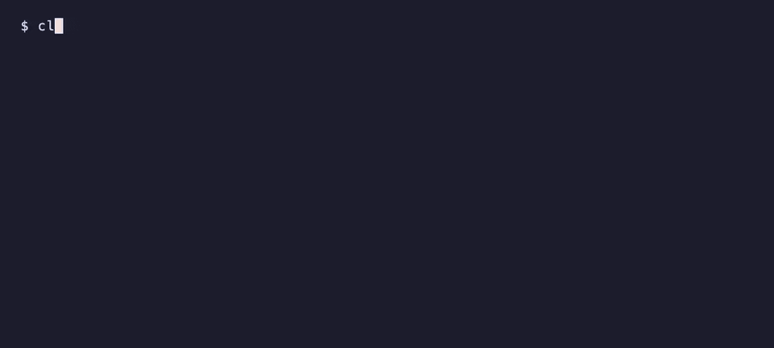
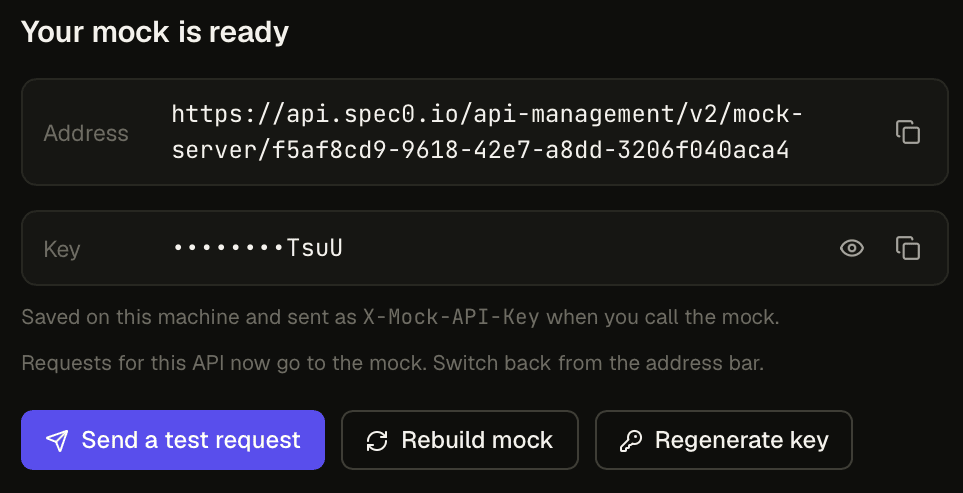
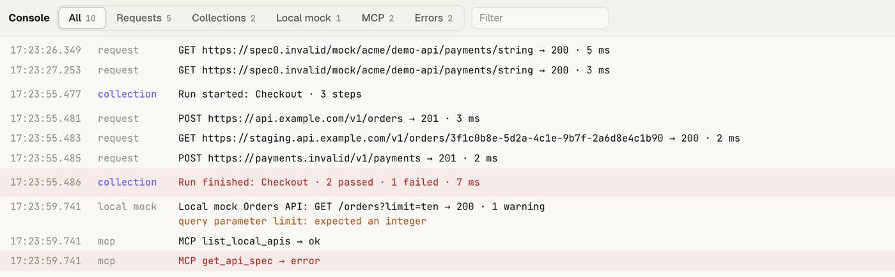

<h1 align="center">
  <picture>
    <source media="(prefers-color-scheme: dark)" srcset=".github/assets/spec0-studio-dark.svg">
    
  </picture>
</h1>

<p align="center">
  <a href="https://github.com/spec-0/studio/releases/latest"></a>
  <a href="https://github.com/spec-0/studio/actions/workflows/ci.yml"></a>
  <a href="LICENSE"></a>
  <a href="https://studio-docs.spec0.io/"></a>
</p>

<h3 align="center">The API client your coding agent can use too.</h3>

<p align="center">
  A desktop app for calling, testing and mocking APIs, built around your OpenAPI spec.<br>
  Free, open source (MIT), and it works without an account.
</p>

<p align="center">
  <a href="#download"><b>Download</b></a> ·
  <a href="https://studio-docs.spec0.io/">User guide</a> ·
  <a href="#how-it-differs">Compared with Postman, Bruno…</a> ·
  <a href="#privacy">Privacy</a> ·
  <a href="https://github.com/spec-0/studio/discussions">Discussions</a>
</p>

<p align="center">
  <br>
  <sub>Starting a local mock from a spec and sending a request to it. The response is checked against the spec.</sub>
</p>

## Why Studio

More and more API work is done by coding agents. An agent drafts the spec,
writes the handlers and tests them, and a developer guides it and reviews the
result, much as with code. So an API tool has to work for both of them.

| When agents do the API work… | …Studio |
|---|---|
| The agent can't use a click-only tool, so it falls back to `curl` and guesses | A local MCP server gives it the APIs open in Studio: it sends requests, runs collections and starts mocks, and you approve where its requests go |
| Someone has to review each change quickly, without reading a YAML diff | Collections show the values passing between steps, every run has a log, and a step that no longer matches a changed spec is marked |
| Judging a change needs a map of the domain, not a list of endpoints | The Graph tab shows which schemas refer to which, and which operations use them |
| Tests fall behind when the API changes with every prompt | One click starts a local mock, and a collection can be re-run after every change |
| Requests, mocks and checks drift away from the spec | All of them are built from the spec, and every JSON response is checked against the schema it declares |

It's young, and we'd like to hear what breaks.

## What you can do

### Send requests built from the spec, and check what comes back

Allowed values become dropdowns and bodies start with the real field names.
Every JSON response is checked against the schema for its status code,
including fields the spec doesn't mention.

<p align="center">
  <br>
  <sub>A response that matches the schema the spec declares.</sub>
</p>

→ Read more: [Requests](https://studio-docs.spec0.io/requests/) · [Checking responses](https://studio-docs.spec0.io/checking-responses/)

### See how the schemas fit together

The Graph tab shows which schemas refer to which, and which operations use
them. Click a schema to see its fields and an example.

<p align="center">
  <br>
  <sub>The Graph tab of a Catalog API.</sub>
</p>

→ Read more: [Schemas](https://studio-docs.spec0.io/schemas/) · [Schema graph](https://studio-docs.spec0.io/schema-graph/)

### Chain requests into collections, and see why a run failed

A collection runs steps in order, often across several specs: create an order,
get it, pay for it. The Chain view shows every value passed between steps, and
each run gets a log that says why a step failed. Postman collections can be
[imported](https://studio-docs.spec0.io/collections/postman/).

<p align="center">
  <picture>
    <source media="(prefers-color-scheme: dark)" srcset=".github/assets/readme/chain-dark.png">
    
  </picture><br>
  <sub>The Chain view of a three-step checkout collection.</sub>
</p>

<details>
<summary><b>A run log</b></summary>
<br>
<p align="center">
  <picture>
    <source media="(prefers-color-scheme: dark)" srcset=".github/assets/readme/run-log-dark.png">
    
  </picture><br>
  <sub>A run log where the third step failed with a schema difference.</sub>
</p>
</details>

→ Read more: [Collections](https://studio-docs.spec0.io/collections/)

### Mock any API on your computer in one click

A local mock answers every operation in the spec, from its examples. It needs
no account and no network, and it stops when Studio quits.

<p align="center">
  
</p>

→ Read more: [Local mocks](https://studio-docs.spec0.io/local-mocks/) · [Hosted mocks](https://studio-docs.spec0.io/hosted-mocks/)

### Let a coding agent work with your APIs

Coding agents such as Claude Code or Cursor connect to Studio's local MCP
server, read the APIs in your library (including specs you haven't published),
and test them through Studio. To stay in Studio, press **Agent** in the top bar
(<kbd>⇧</kbd><kbd>⌘</kbd><kbd>J</kbd>) to chat with Claude, Codex or Gemini CLI.

<p align="center">
  <br>
  <sub>A coding agent asks Studio which APIs are open, then calls a mock.</sub>
</p>

→ Read more: [Local MCP server](https://studio-docs.spec0.io/mcp/) · [Agent chat](https://studio-docs.spec0.io/agent-chat/)

<details>
<summary><b>More screenshots</b></summary>

<br>

A hosted mock to share with your team (needs the optional [Spec0 connection](https://studio-docs.spec0.io/connect/)):

<p align="center">
  
</p>

The console, with requests, a collection run, a local mock request and MCP tool calls:

<p align="center">
  <picture>
    <source media="(prefers-color-scheme: dark)" srcset=".github/assets/readme/console-dark.png">
    
  </picture>
</p>

</details>

## Download

These links always point to the newest version:

| Platform | File | Notes |
|---|---|---|
| macOS 11 or later | [spec0-studio-macos-universal.dmg](https://github.com/spec-0/studio/releases/latest/download/spec0-studio-macos-universal.dmg) | Apple silicon and Intel. Signed and notarized by Apple. |
| Windows 10 and 11, x64 | [spec0-studio-windows-x64-setup.exe](https://github.com/spec-0/studio/releases/latest/download/spec0-studio-windows-x64-setup.exe) | Installs for your user only, no admin rights needed. Not code-signed, see the note below. |
| Linux x86_64 | [spec0-studio-linux-x86_64.AppImage](https://github.com/spec-0/studio/releases/latest/download/spec0-studio-linux-x86_64.AppImage) | Most distributions. Run `chmod +x` on it, then run it. |
| Debian, Ubuntu, x86_64 | [spec0-studio-linux-amd64.deb](https://github.com/spec-0/studio/releases/latest/download/spec0-studio-linux-amd64.deb) | `sudo apt install ./spec0-studio-linux-amd64.deb` |

Checksums, WebView2 on Windows and the Linux requirements are in
[Install](https://studio-docs.spec0.io/install/). Studio updates itself when you
ask (*Check for Updates…*), and every update is signed.

> [!TIP]
> No account needed. Requests, response checks, collections, local mocks and the
> MCP server all run on your computer, without signing in.

> [!NOTE]
> The Windows installer isn't code-signed yet, because we don't have a Windows
> code-signing certificate. Windows SmartScreen will probably say "Windows
> protected your PC" and call the publisher unknown. To continue, click
> **More info**, then **Run anyway**. If you'd rather not, check the file against
> `SHA256SUMS.txt` first (in PowerShell: `Get-FileHash .\spec0-studio-windows-x64-setup.exe`),
> or [build Studio from source](#build-from-source).

## How it differs

| Collection-first clients (Postman, Insomnia, Bruno, Yaak) | Spec0 Studio |
|---|---|
| The collection is the main thing; a spec can be imported to start one | Requests come from the spec, and collections point at its operations instead of copying them |
| Checking a response mostly means writing a test | Every JSON response is checked against the schema the spec declares, and fields it doesn't mention are flagged |
| Accounts and cloud storage vary by tool | No account and no telemetry; history and environments stay on your machine |
| More mature, and they do more | Younger and does less: no scripting, shared team workspace, command-line runner, gRPC or WebSocket yet. Postman collections import (scripts aren't run); Insomnia and Bruno files don't yet |

## Privacy

Studio is often used with private, internal APIs, so it talks only to the
servers you point it at.

- No telemetry, analytics or crash reporting. Studio makes no request you didn't ask for.
- Secrets live in your operating system's credential store (Keychain, Credential
  Manager, Secret Service) and appear as `{{name}}` everywhere else.
- The MCP server and local mocks listen on `127.0.0.1` only and are off until you
  start them. An agent's first request to each host waits for your approval.
- Update checks happen only when you ask.

→ [Everything Studio does and doesn't send](https://studio-docs.spec0.io/privacy/)

> [!WARNING]
> If the credential store can't be reached (mostly on Linux without a running,
> unlocked keyring such as GNOME Keyring or KWallet), Studio keeps secret values
> in a local file that is not encrypted, and says so in the environments dialog.
> The values move to the credential store the next time Studio starts and can reach it.

## Known limitations

<details open>
<summary><b>What Studio doesn't do yet</b></summary>

- **Only JSON response bodies are checked.** Headers, content types and undeclared status codes aren't.
- **Collections run in Studio only.** There is no command-line runner, and an OAuth step uses the token Studio already holds.
- **A Postman import doesn't bring everything across.** Scripts aren't run; the summary says what was skipped.
- **The Windows and Linux builds are new**, x86_64 only, and have had much less use than the Mac build.
- **Linux needs WebKitGTK 4.1**: Ubuntu 22.04, Debian 12 or newer.
- **Update checks don't use your certificate settings**, so a network with a private CA may block them.
- **A local mock answers from examples, not state.** A `POST` doesn't change the next `GET`, and XML is sent as JSON.
- **Some example values are placeholders**, like `"string"`, when the spec gives nothing better.
- **Agent chat is new.** The ACP adapters are young, and a past chat can be read but not continued.
- **The app may make HTTP requests to any host**, because an API client has to reach whatever address you give it.

Details and workarounds are in [Troubleshooting](https://studio-docs.spec0.io/troubleshooting/).

</details>

## Build from source

You need Node 22.12 or later (CI uses Node 24) and Rust 1.90 or later. On Linux
you also need [Tauri's system packages](https://v2.tauri.app/start/prerequisites/#linux)
(WebKitGTK 4.1 and a few others).

```bash
npm install
npm run app            # run the desktop app
npm run dev            # preview the interface in a browser at localhost:5173
```

The browser preview is handy for styling, but requests to other sites will be
blocked by CORS there, because it is a web page. In the desktop app they go out
through Rust. The status bar tells you which one you are in.

```bash
npm test               # unit tests
npm run type-check     # TypeScript check
npm run app:build      # installers for your platform (.dmg, .AppImage/.deb, .exe)
```

## Feedback and contributing

- **Questions, ideas, or "I tried it, here's what I thought"**: start a thread in
  [Discussions](https://github.com/spec-0/studio/discussions).
- **Bugs**: [open an issue](https://github.com/spec-0/studio/issues/new/choose).
- **Security problems**: report them privately, as described in [SECURITY.md](SECURITY.md),
  rather than in a public issue.
- **Pull requests** are welcome. Please read [CONTRIBUTING.md](CONTRIBUTING.md) first.
- **The user guide** at [studio-docs.spec0.io](https://studio-docs.spec0.io/) is
  written in [docs/user](docs/user/) and built by [site/](site/). A fix or a new page is a
  pull request there.

## Licence

MIT, copyright (c) 2026 Spec0. See [LICENSE](LICENSE).
The Spec0 name and logo are used to identify this project and aren't covered by the MIT licence.
